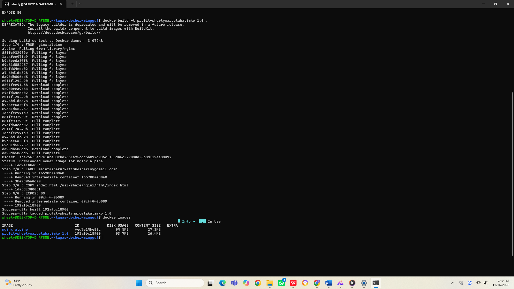
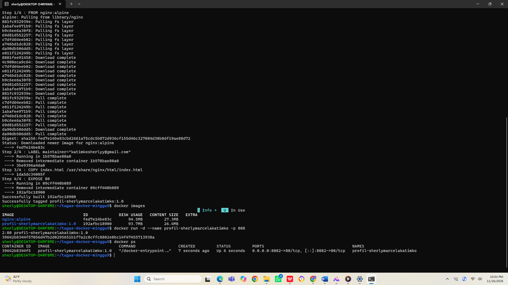
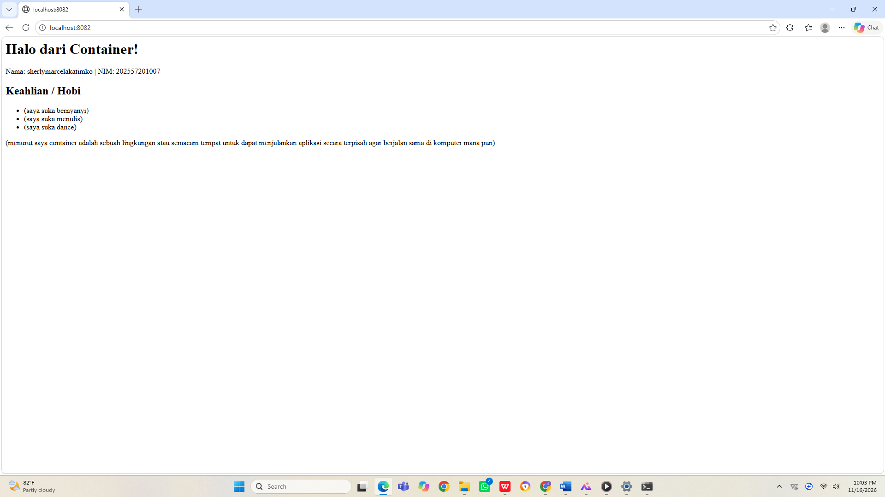

# TUGAS DOCKER MINGGU 9
## Kontainerisasi Halaman Profil dengan Docker

### Deskripsi
Proyek ini merupakan tugas praktikum Teknologi Open Source Minggu 9. Pada tugas ini saya membuat halaman profil pribadi menggunakan HTML, kemudian menjalankannya menggunakan Docker dengan bantuan Nginx.

### 1. Cara Build Image

Build Image merupakan proses membuat Docker Image berdasarkan instruksi yang terdapat pada Dockerfile.

Perintah yang digunakan:

```bash
docker build -t profil-sherlymarcelakatimko:1.0 .
```

Keterangan:
- `docker build` : Membuat Docker Image.
- `-t` : Memberikan nama dan versi pada Image.
- `profil-sherlymarcelakatimko` : Nama Image.
- `1.0` : Versi Image.
- `.` : Menunjukkan lokasi Dockerfile berada di folder saat ini.

Untuk melihat Image yang berhasil dibuat, gunakan perintah:

```bash
docker images
```

### 2. Cara Run Container

Run Container merupakan proses menjalankan Docker Image menjadi sebuah Container.

Perintah yang digunakan:

```bash
docker run -d --name profil-sherlymarcelakatimko -p 8082:80 profil-sherlymarcelaktimko:1.0
```

Keterangan:
- `docker run` : Membuat dan menjalankan Container.
- `-d` : Menjalankan Container di background.
- `--name profil-sherlymarcelakatimko` : Memberikan nama Container.
- `-p 8082:80` : Menghubungkan port 8082 pada komputer dengan port 80 pada Container.
- `profil-sherlymarcelakatimko:1.0` : Image yang digunakan.

Untuk melihat Container yang sedang berjalan, gunakan perintah:

```bash
docker ps
```

### 3. Hasil Screenshot

#### A. Hasil Build Image


#### B. Hasil Run Container


#### C. Tampilan Halaman Profil


### 4. Kesimpulan

Melalui proyek ini, saya dapat memahami cara membuat Docker Image, menjalankan Image menjadi Container, dan menampilkan halaman profil melalui browser menggunakan alamat localhost:8082.


## 5. Docker Hub

Docker Image dari project ini berhasil diunggah ke Docker Hub.

- **Username:** katimkosherly
- **Nama Image:** profil-sherlymarcelakatimko
- **Tag:** 1.0
- **Link Docker Hub:** https://hub.docker.com/r/katimkosherly/profil-sherlymarcelakatimko

### Perintah untuk Mengambil Image

```bash
docker pull katimkosherly/profil-sherlymarcelakatimko:1.0
```

